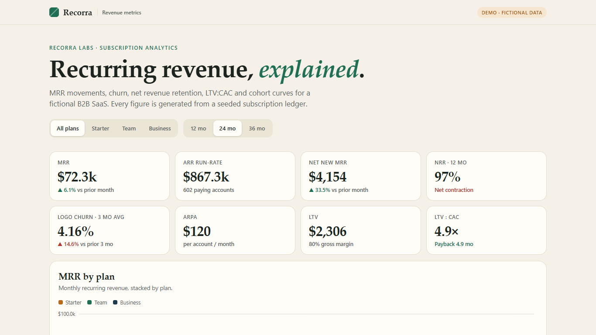
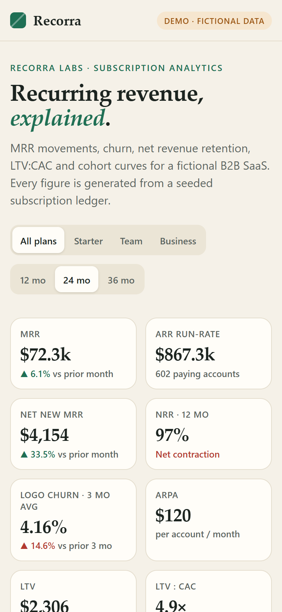

# Recorra — SaaS metrics dashboard

Interactive subscription-analytics dashboard: **MRR movements, churn, NRR, LTV:CAC and cohort retention**.

**Live demo:** https://alissonlittig.github.io/recorra-saas-metrics/

> Demo only. *Recorra Labs* is a fictional company and every number is synthetic, generated by a seeded Python ETL. Not real financials.




## What it shows
- MRR by plan (stacked area) and MRR movements: new, expansion, contraction, churn, net new
- Logo churn vs. gross revenue churn, 12-month compounded NRR, ARPA, LTV, CAC, LTV:CAC and payback
- Cohort retention heatmap by logos or revenue
- Filters by plan and period (12 / 24 / 36 months), tooltips, plan breakdown table

## Stack
- **Python ETL** (`etl/build_data.py`): simulates a 36-month subscription ledger per customer (signup, seat expansion/contraction, tenure-dependent churn) and aggregates it to monthly metrics + cohort matrices.
- **Front end:** vanilla JS, hand-built SVG charts (no chart library), Vite.
- **Tests:** `unittest` checks ledger invariants (MRR waterfall reconciles, logo roll-forward, cohorts sum to active customers); `node:test` checks metric helpers.
- **CI:** GitHub Actions runs both test suites, builds and deploys to GitHub Pages.

## Definitions
| Metric | Formula |
|---|---|
| NRR (12 mo) | product of monthly (start + expansion − contraction − churn) / start |
| LTV | ARPA × 80% gross margin ÷ 3-month average logo churn |
| CAC | modeled cost per new logo by plan (fictional inputs) |
| Payback | CAC ÷ (ARPA × gross margin) |

## Run locally
```bash
npm ci
npm run data        # regenerate public/data.json (Python 3.10+)
npm run test:etl && npm test
npm run dev
```
